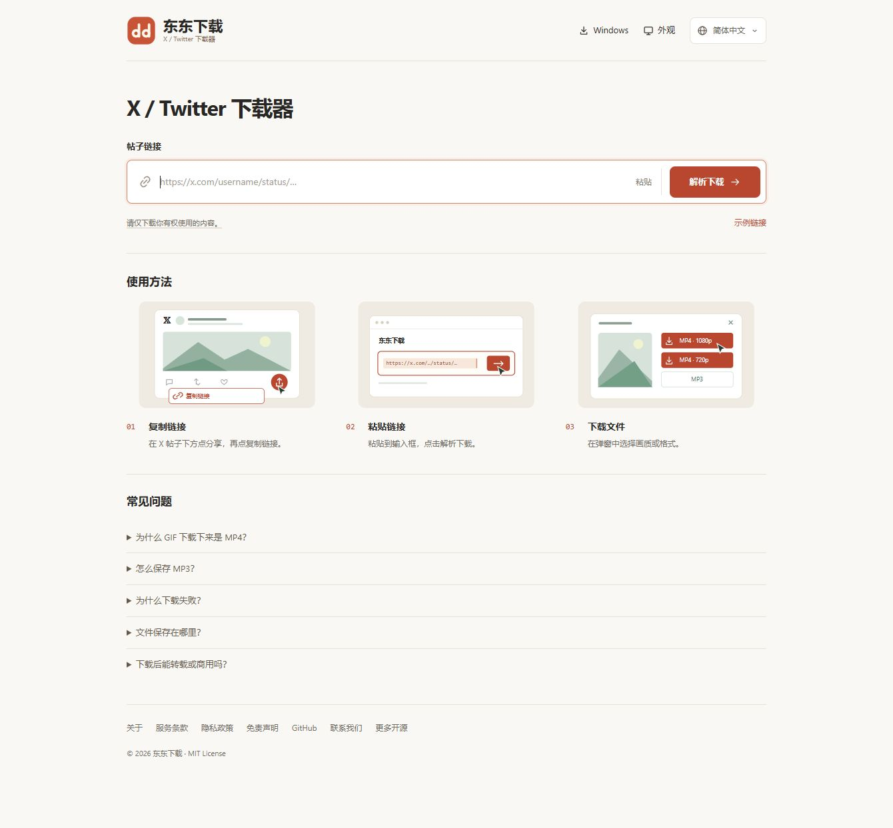

<p align="center"></p>

<h1 align="center">东东下载</h1>

<p align="center">下载公开 X / Twitter 帖子中的视频、图片和 GIF，也能提取 MP3。</p>

<p align="center">
  <a href="https://x.dd-oss.com/">在线演示</a> ·
  <a href="https://x.dd-oss.com/download/windows">Windows 下载</a> ·
  <a href="https://github.com/274335390/x-download/releases/tag/v1.0.1">1.0.1 发布说明</a> ·
  <a href="https://github.com/274335390/x-download/issues">问题反馈</a> ·
  <a href="LICENSE">MIT License</a>
</p>



## 功能

- **视频与图片**：按画质下载 MP4、保存图片和视频封面，多文件可打包 ZIP。
- **格式转换**：有声视频提取 MP3，X 动图可保存为 MP4 或转换 GIF。
- **网页与 Windows**：共用一套界面，下载进度显示在按钮内。
- **外观与语言**：浅色、深色、跟随系统，支持 30 种界面语言。
- **免费使用**：无需注册，没有广告。下载前需确认内容使用权限。

## 开始使用

打开 **[x.dd-oss.com](https://x.dd-oss.com/)**，粘贴公开帖子链接，点击“解析下载”，再选择画质或格式。

Windows 用户可下载 `Dongdong.exe`，双击运行。适用于 Windows 10/11（64 位）；独立窗口使用 Microsoft Edge WebView2 Runtime，多数较新 Windows 已安装。无需另装 Python 或 FFmpeg。桌面版仅在用户点击“检查更新”时检查版本，不强制更新。

当前 EXE 尚未进行代码签名，首次下载可能出现 Edge / SmartScreen 信誉提示。请从本站或正式 [GitHub Release](https://github.com/274335390/x-download/releases/tag/v1.0.1) 获取，并用发布页的 SHA-256 校验文件一致性。校验值不等于代码签名，也不能保证安全；出现具体病毒告警时应停止运行并反馈。

## 本地运行

需要 Python 3.10+。网页版默认由浏览器下载和转换媒体，无需安装本机 FFmpeg；如使用下方的服务器处理模式，MP3 / GIF 转换需安装 FFmpeg 并加入 PATH。

```bash
git clone https://github.com/274335390/x-download.git
cd x-download
python -m venv .venv
```

激活虚拟环境后安装并启动：

```bash
# Windows: .venv\Scripts\activate
# macOS / Linux: source .venv/bin/activate
pip install -r requirements.txt
python scripts/fetch-browser-vendor.py
python app.py --web
```

访问 `http://127.0.0.1:18765`。前端需要配套后端解析帖子，单独打开 HTML 或只上传到 GitHub Pages 不能完成整个流程。

浏览器依赖按固定版本及哈希校验下载。也可以在开发电脑执行后，把生成的 `web/vendor/` 一起部署；该目录不提交到 Git。普通 MP4、图片下载无需这些依赖，ZIP 和格式转换需要。

## 部署与开发

| 目录 / 文件 | 用途 |
| --- | --- |
| `app.py` | 解析、下载、转换和桌面入口 |
| `web/` | HTML、样式、多语言和交互 |
| `deploy/` | Linux 服务与 Nginx 配置示例 |
| `build.ps1` | Windows 打包 |

服务器部署、HTTPS 自动续期和 Windows 打包见 **[部署说明](docs/deployment.md)**。第三方组件见 [THIRD_PARTY.md](THIRD_PARTY.md)。

### 网页处理模式

通过环境变量 `XDOWNLOAD_WEB_PROCESSING` 选择，修改后重启应用：

| 值 | 下载和转换在哪里处理 |
| --- | --- |
| `browser`（默认） | 后端只解析帖子；浏览器直连 X 媒体 CDN，下载、ZIP 打包和 MP3 / GIF 转换在用户设备上完成 |
| `server` | 保留后端流式下载、ZIP 打包和 FFmpeg 转换，媒体流量经过部署服务器 |

例如 Linux 上运行 `XDOWNLOAD_WEB_PROCESSING=server python app.py --web`；PowerShell 中先设置 `$env:XDOWNLOAD_WEB_PROCESSING='server'`，再启动应用。Windows 桌面版始终在本机处理，不受此开关影响。

浏览器模式要求用户网络能访问 `video.twimg.com` 和 `pbs.twimg.com`，且上游响应允许跨域读取。连接失败时页面会提示，不会自动改用服务器转发；此模式也会关闭后端媒体代理入口。解析请求和网页资源仍由服务器提供。

浏览器转换按需加载随项目提供的 FFmpeg WebAssembly 文件，比本机 FFmpeg 慢，并消耗用户设备的 CPU 和内存；大文件或性能较低的手机更适合下载原文件后处理。网页需通过 HTTPS 或本机 `localhost` / `127.0.0.1` 使用。

## 使用范围

仅支持可访问的公开帖子，不支持私密帖子、直播或整个账号。单次下载（含 ZIP）上限 256 MB；GIF 转换为 640 px、12 fps，最多处理前 120 秒。解析依赖 FxEmbed、yt-dlp 和 X 媒体服务，上游变化或限流可能导致失败。

默认网页模式在浏览器内处理媒体，不把媒体下载到部署服务器；服务器模式流式处理，不主动创建媒体临时文件。浏览器和操作系统仍可能使用下载缓存。语言和外观偏好保存在本地，不保存下载历史数据库。

请仅下载你拥有版权、已获许可或依法有权使用的内容。个人使用不等于自动获得授权；未经授权，不得转载、分发或用于商业活动。本项目与 X / Twitter 无隶属或背书关系。

## 反馈与许可

- 使用问题或建议：[GitHub Issues](https://github.com/274335390/x-download/issues)。
- 版权、隐私或其他联系：[sddaspirine@gmail.com](mailto:sddaspirine@gmail.com)。请附问题描述和相关帖子链接，勿发送密码或其他敏感信息。
- 项目源码采用 [MIT](LICENSE) 许可证；媒体内容和第三方组件保留各自权利及许可。

更多项目：[东东开源](https://dd-oss.com/)。
